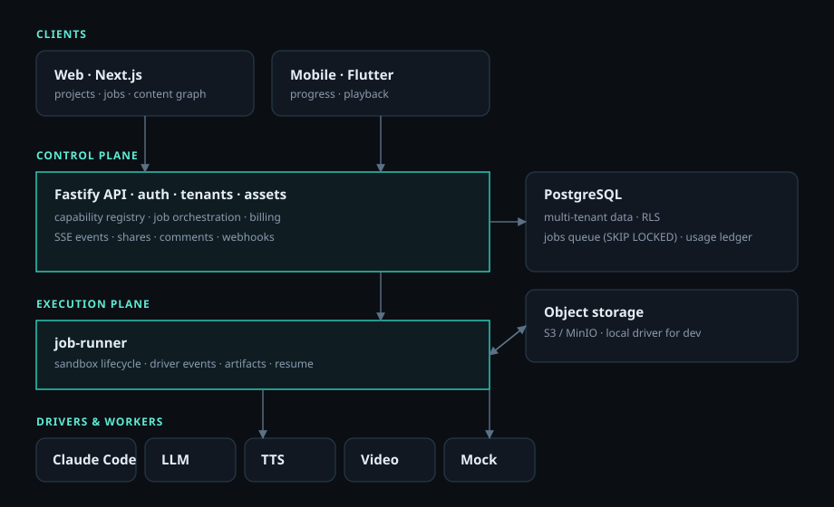
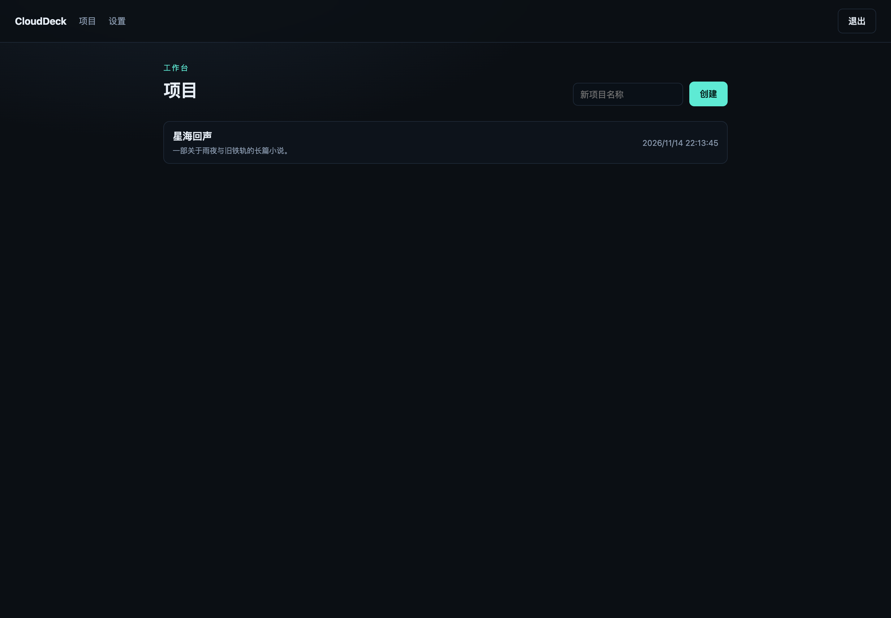
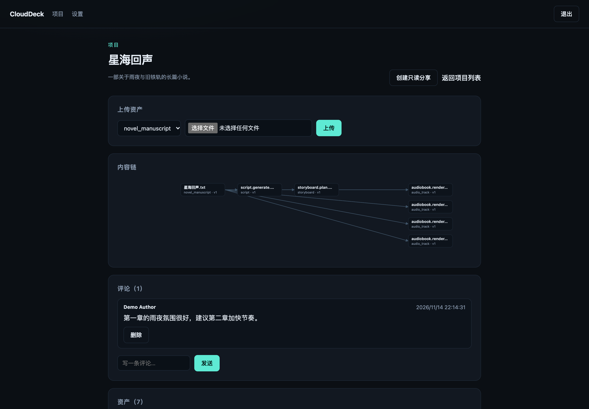
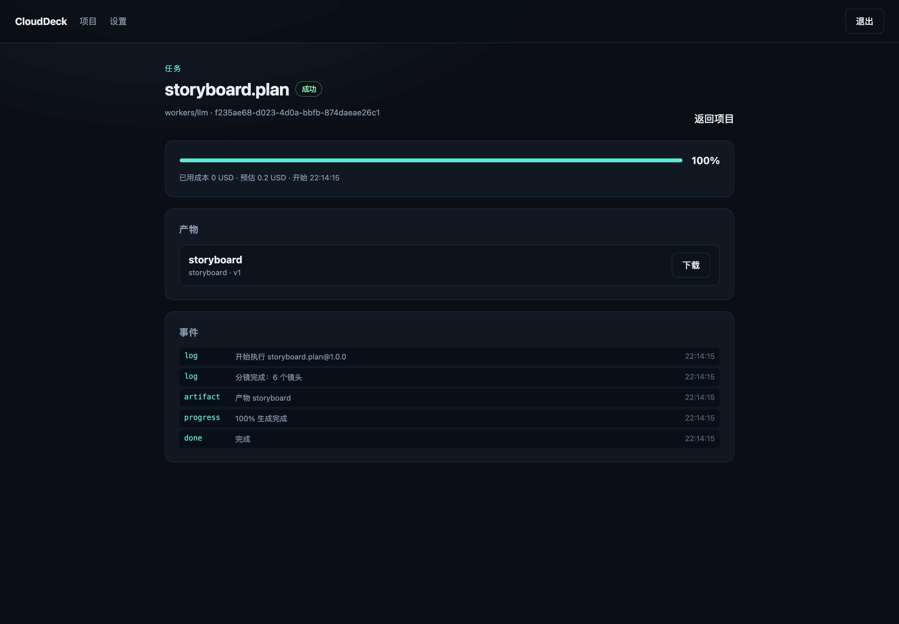
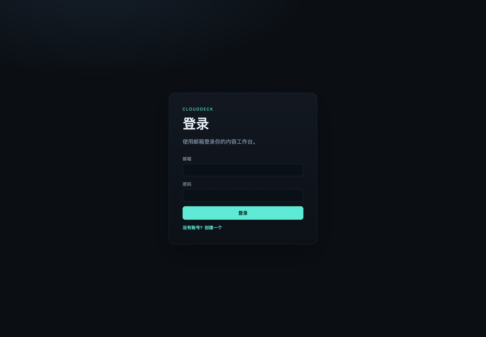

# CloudDeck

[](https://github.com/wly2lcl/CloudDeck/actions/workflows/ci.yml)
[](LICENSE)
[](package.json)
[](package.json)
[](https://wly2lcl.github.io/CloudDeck/)

**English** | [简体中文](README.zh.md)

CloudDeck is a self-hostable AI content production workbench. It turns one idea
into a publishable novel, script, storyboard, audiobook, or video, and lets every
step run on a different engine.

Two ideas define the project:

1. **Content asset chain** — novel, script, storyboard, audio, and video are
   stages of one production line, sharing projects, characters, settings, and versions.
2. **Pluggable capabilities** — every capability declares a contract; engines
   (Claude Code, OpenCode, dsh, custom LLM/TTS/video pipelines) are adapters that
   can be swapped, gray-released, or replaced without touching the platform or clients.



## Screenshots

| Projects | Content chain |
|---|---|
|  |  |
| **Job progress** | **Sign in** |
|  |  |

## Features

- Multi-tenant workspace: accounts, roles, projects, versioned assets, content graph.
- Capability registry: manifest, I/O schema, permissions, budget, driver routing.
- Durable jobs: PostgreSQL queue, SSE progress, cancel, retry, checkpoint resume.
- Delivery: signed webhooks with retries and manual replay.
- Sandboxes: local process or Docker (optional gVisor runtime), per-job workspace.
- Drivers: Claude Code with vector RAG (BAAI/bge-m3), lexical fallback, and citations artifact, OpenAI-compatible LLM with fallback gateway and control-plane `/gateway/chat`, DashScope TTS with voice-profile library, concurrent chunks, and EBU R128 loudnorm, ffmpeg video with selectable transitions, multi-track SRT editor with waveform drag, live preview, merge export, and simultaneous burn-in, and styled subtitle burn-in.
- Commercial: plans and quotas with pre-deduction, usage ledger, reconciliation,
  invoice snapshots, capability toggles, templates and public template market,
  read-only shares, member management and tenant audit logs.
- Collaboration: project comments with an SSE stream, optional project-level ACL, and a Yjs real-time shared draft.
- Security: JWT with refresh rotation and client auto-refresh, scoped API keys,
  password reset / email verification, AES-256-GCM model credentials, Helmet,
  rate limiting, raw-body HMAC webhooks, tenant audit logs.
- Clients: Next.js web app with zh/en UI toggle and Flutter mobile app with zh/en toggle (projects, assets, jobs, comments, content-chain DAG, settings/quota, push-token registration).
- Ops: Docker Compose, Kubernetes manifests, Prometheus alerts, storage/workspace cleanup, backup/restore scripts, queue load test.
- Platform admin: cross-tenant list, plan/quota overrides, global capability toggles, cross-tenant jobs.
- Invitations: invite unregistered emails, accept and join a tenant, pending-invite list.
- Email delivery: mock, HTTP gateway, or SMTP for verification, password reset, and invitations.

## Quick start

### Full stack with Docker

```sh
git clone https://github.com/wly2lcl/CloudDeck.git
cd CloudDeck
cp infra/compose/.env.example infra/compose/.env
docker compose -f infra/compose/docker-compose.yml up --build
```

- Web: <http://localhost:3000>
- API: <http://localhost:4310>
- Default storage is a named volume; Postgres data persists in `pgdata`.

### Local development

```sh
pnpm install
docker compose -f infra/compose/docker-compose.yml up -d postgres
pnpm dev        # control plane :4310, job-runner, web :3000
```

Checks (tests use in-process PGlite and do not need Docker; coverage thresholds are 75% lines / 45% branches):

```sh
pnpm check              # lint, typecheck, tests, coverage, boundaries, OpenAPI
cd apps/mobile && flutter analyze && flutter test
```

Browser E2E:

```sh
docker compose -f infra/compose/docker-compose.yml up -d --build
pnpm exec playwright test
```

## Configure model engines

CloudDeck works without external models for the demo capability. To use real engines:

| Engine | Environment |
|---|---|
| OpenAI-compatible LLM | `LLM_HTTP_URL`, `LLM_MODEL`, `LLM_HTTP_TOKEN` (optional `LLM_MAX_ATTEMPTS`, `LLM_RETRY_BASE_MS`) |
| Alibaba Bailian TTS | `TTS_PROVIDER=dashscope`, `TTS_MODEL=qwen-audio-3.1-tts-flash`, `BAILIAN_API_KEY` |
| Claude Code | `ANTHROPIC_API_KEY`; optional `CLAUDE_BIN`, `SANDBOX_DRIVER=docker` |
| Video | `ffmpeg` available on the host or inside the runner image |

Tenants can also store their own keys under **Settings → Model credentials**;
they are encrypted with AES-256-GCM and injected at job runtime.

## Capabilities

| ID | What it does | Default driver |
|---|---|---|
| `novel.edit` | Continue, rewrite, or check a manuscript | Claude Code |
| `script.generate` | Novel → acts/scenes script | LLM |
| `storyboard.plan` | Script → structured shots | LLM |
| `audiobook.render` | Multi-voice audiobook with resume | TTS |
| `video.render` | Storyboard + audio → MP4 and SRT | ffmpeg |
| `coding.assist` | Code workspace → patch notes | Claude Code |
| `demo.echo` | End-to-end smoke capability | Mock |

## Repository layout

```text
apps/web            Next.js client
apps/mobile         Flutter client
services/           control-plane, job-runner
packages/           contracts, db, storage, sandbox, secrets, ui
drivers/            engine adapters (mock, claude-code)
workers/            tts, llm, video
capabilities/       capability packages
infra/              compose, Dockerfiles, deployment
docs/               architecture, contracts, API, ADRs, deployment
```

## Documentation

| Doc | Contents |
|---|---|
| [Product](docs/00-product.md) | scope, users, success metrics |
| [Architecture](docs/01-architecture.md) | layers, contracts, runtime |
| [Contracts](docs/02-contracts.md) | manifest, driver, events, assets |
| [Data model](docs/03-data-model.md) | multi-tenant schema, content chain |
| [Capabilities](docs/04-capabilities.md) | capability designs and acceptance |
| [Drivers](docs/05-drivers.md) | Claude Code, ACP, pipeline, sandbox |
| [API](docs/06-api.md) · [OpenAPI](docs/openapi.yaml) | REST, SSE, error codes |
| [Security & billing](docs/08-security-billing.md) | sandbox, secrets, quotas |
| [Deployment](docs/deployment.md) | compose, production, GPU, keys |
| [Kubernetes](infra/k8s/README.md) | production manifests |
| [Observability](infra/observability/README.md) | metrics, alerts, logs |
| [Limitations](docs/limitations.md) | known gaps and unblock conditions |
| [LLM eval](docs/15-llm-eval.md) | fixed cases, scoring, model comparison |
| [Compliance](docs/13-compliance.md) | legal and content checklist |
| [ADRs](docs/adr/) | 17 architecture decisions |
| [Docs site](https://wly2lcl.github.io/CloudDeck/) | Rendered documentation and ADRs |

## Limitations

Real model quality depends on the endpoint you configure. The TTS and video
pipelines are verified with real services only when credentials are supplied.
gVisor support exists in code but requires installing `runsc`. Payment, mobile
push, and tax invoices ship with mock/HTTP providers; real channels need external
accounts. See [docs/limitations.md](docs/limitations.md).

## Contributing

CI runs lint, type checks, coverage, boundary checks, OpenAPI validation, web build, Flutter analyze/test, and a Playwright browser E2E suite. Published releases are smoke-tested by pulling the GHCR images.

See [CONTRIBUTING.md](CONTRIBUTING.md). Security reports go through
[GitHub Security Advisories](SECURITY.md). By participating you agree to the
[Code of Conduct](CODE_OF_CONDUCT.md).

## License

[MIT](LICENSE). Third-party components and engine terms are listed in
[THIRD_PARTY_NOTICES.md](THIRD_PARTY_NOTICES.md).
