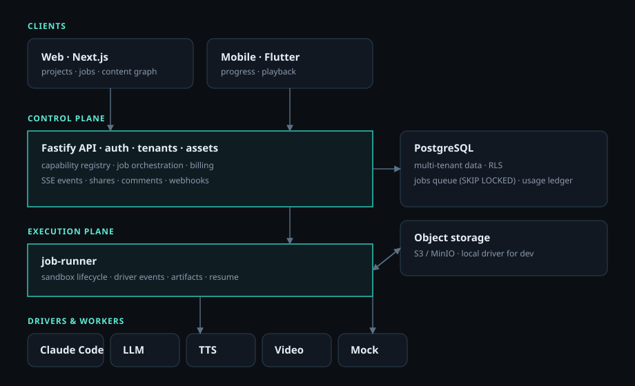
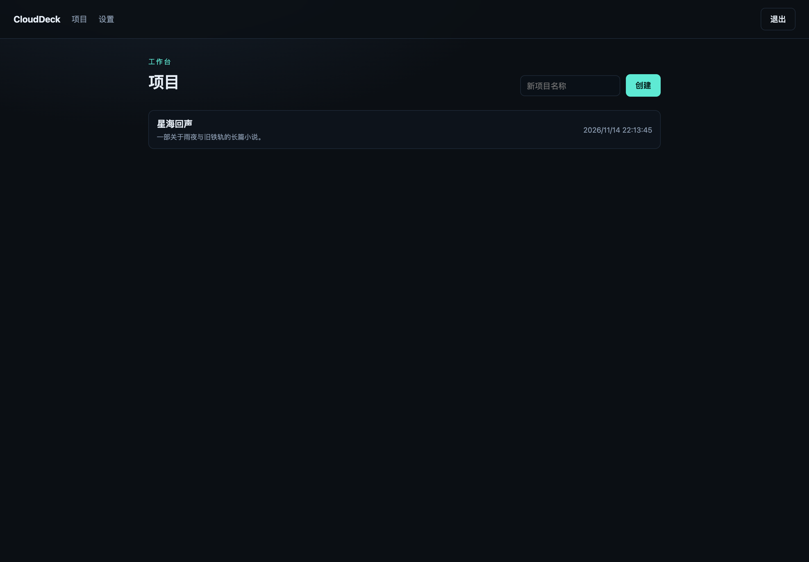
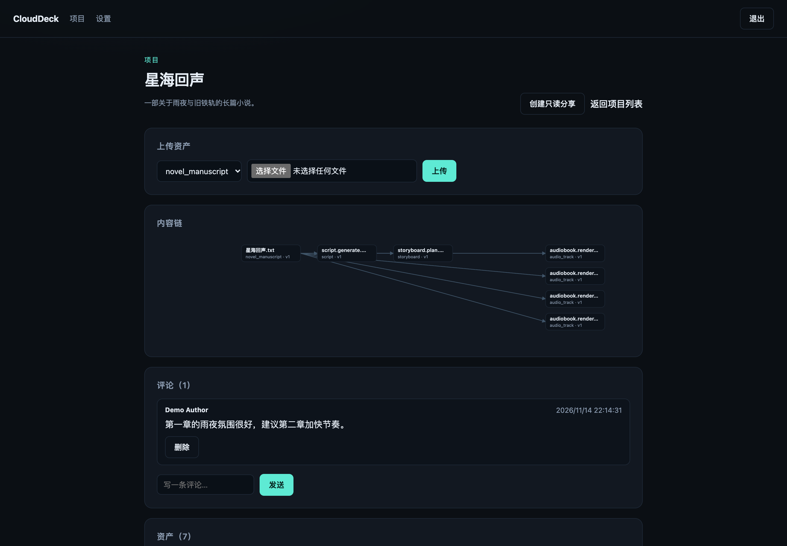
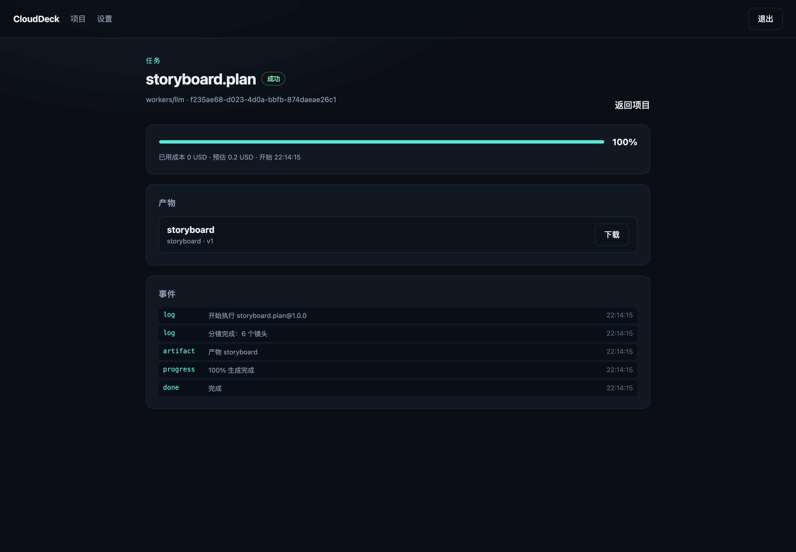
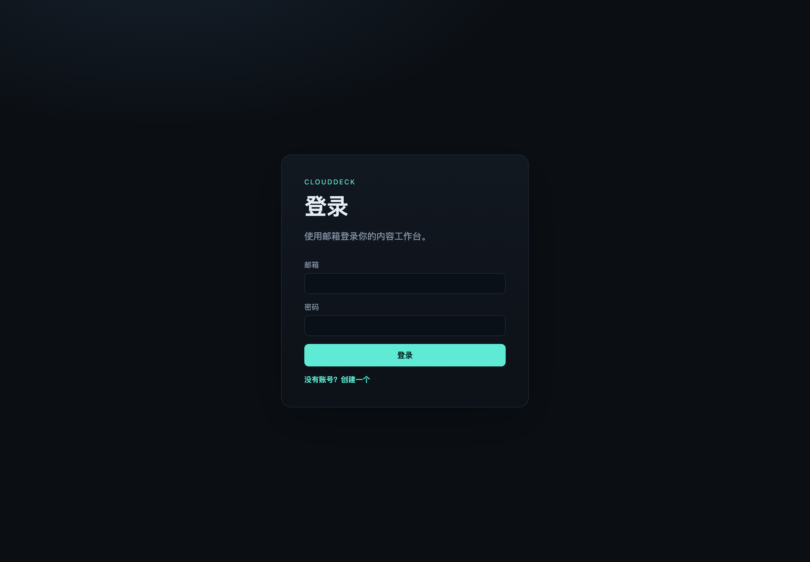

# CloudDeck

[](https://github.com/wly2lcl/CloudDeck/actions/workflows/ci.yml)
[](LICENSE)
[](https://wly2lcl.github.io/CloudDeck/)

[English](README.md) | **简体中文**

CloudDeck 是可自托管的 AI 内容生产工作台：把「一个想法」推进到可发布的小说、剧本、分镜、有声书或视频，并让每个环节可以由不同的 AI 引擎完成。

两条核心主张：

1. **内容资产链**——小说、剧本、分镜、有声、视频是同一条内容链上的工序，共享项目、角色、设定与版本。
2. **能力可插拔**——每个能力只声明契约；Claude Code、OpenCode、dsh、自研 LLM/TTS/视频流水线都是可替换的适配器。



## 界面

| 项目列表 | 内容链 |
|---|---|
|  |  |
| **任务进度** | **登录** |
|  |  |

## 功能

- 多租户：账号、角色、项目、资产版本、内容链图
- 能力注册表：manifest、IO schema、权限、预算、driver 路由
- 任务：Postgres 队列、SSE 进度、取消、重试、断点续作
- 投递：签名 Webhook，自动重试与手动 replay
- 沙箱：本地进程或 Docker（可选 gVisor），每任务独立工作区
- 引擎：Claude Code（章节级 RAG-lite）、OpenAI 兼容 LLM（主备降级 + 控制面 `/gateway/chat` 预算代理）、百炼 TTS（峰值归一 + 并发分块）、ffmpeg 视频（淡入淡出）
- 商业化：套餐配额（预扣）、用量账本、对账、账单快照、能力开关、模板市场、只读分享、成员管理、租户审计
- 协作：项目评论与 SSE 实时流；可选项目级 ACL；Yjs 实时共享草稿
- 安全：JWT refresh 轮换与客户端自动续期、API Key、密码重置/邮箱验证、AES-256-GCM 凭据、Helmet、限流、原始 body HMAC 回调、审计日志
- 客户端：Next.js Web（中英切换）与 Flutter 移动端（中英切换；项目、资产、任务、评论、内容链 DAG、设置/配额、推送令牌注册）
- 运维：Docker Compose、Kubernetes 清单、Prometheus 告警、存储/工作区清理、备份/恢复脚本、队列压测
- 平台管理：跨租户列表、套餐/配额覆盖、全局能力开关、跨租户任务
- 邀请：邀请未注册邮箱、接受后加入租户、待接受列表
- 邮件：mock、HTTP 网关或 SMTP，发送验证、重置密码与邀请

## 快速开始

### Docker 全栈

```sh
git clone https://github.com/wly2lcl/CloudDeck.git
cd CloudDeck
cp infra/compose/.env.example infra/compose/.env
docker compose -f infra/compose/docker-compose.yml up --build
```

- Web: <http://localhost:3000>
- API: <http://localhost:4310>

### 本地开发

```sh
pnpm install
docker compose -f infra/compose/docker-compose.yml up -d postgres
pnpm dev        # 控制面 :4310 + job-runner + Web :3000
```

检查与测试（测试使用进程内 PGlite，不依赖 Docker）：

```sh
pnpm check
cd apps/mobile && flutter analyze && flutter test
```

## 配置模型引擎

| 引擎 | 环境变量 |
|---|---|
| OpenAI 兼容 LLM | `LLM_HTTP_URL`、`LLM_MODEL`、`LLM_HTTP_TOKEN` |
| 阿里云百炼 TTS | `TTS_PROVIDER=dashscope`、`TTS_MODEL=qwen-audio-3.1-tts-flash`、`BAILIAN_API_KEY` |
| Claude Code | `ANTHROPIC_API_KEY`；可选 `CLAUDE_BIN`、`SANDBOX_DRIVER=docker` |
| 视频 | 宿主或 runner 镜像内有 `ffmpeg` |

租户也可以在「设置 → 模型凭据」保存自己的密钥，AES-256-GCM 加密，任务运行时注入。

## 文档

- [产品定义](docs/00-product.md)
- [架构](docs/01-architecture.md) / [契约](docs/02-contracts.md)
- [数据模型](docs/03-data-model.md) / [能力](docs/04-capabilities.md) / [驱动](docs/05-drivers.md)
- [API](docs/06-api.md) / [OpenAPI](docs/openapi.yaml)
- [安全与计费](docs/08-security-billing.md) / [部署](docs/deployment.md) / [限制](docs/limitations.md)
- [Kubernetes 清单](infra/k8s/README.md) / [可观测性](infra/observability/README.md)
- [合规](docs/13-compliance.md) / [ADR](docs/adr/)
- [在线文档站](https://wly2lcl.github.io/CloudDeck/)

## 已知限制

真实模型质量取决于配置的端点；TTS 与视频只在提供凭据时验证；gVisor 代码就绪但需安装 `runsc`；支付、移动推送、税务发票使用 mock/http provider，真实渠道需要外部账号。详见 [docs/limitations.md](docs/limitations.md)。

## 贡献

见 [CONTRIBUTING.md](CONTRIBUTING.md)。安全问题请走 [GitHub Security Advisories](SECURITY.md)。

## 许可证

[MIT](LICENSE)。第三方组件与引擎条款见 [THIRD_PARTY_NOTICES.md](THIRD_PARTY_NOTICES.md)。
